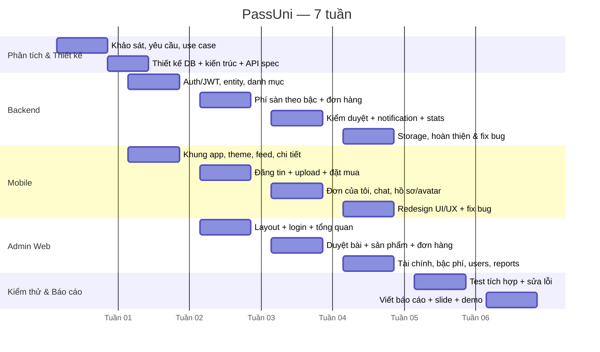

# KẾ HOẠCH THỰC HIỆN DỰ ÁN — PASSUNI (7 TUẦN / 6 THÀNH VIÊN)

> **Đề tài:** Chợ đồ cũ sinh viên PassUni — Ứng dụng Android (Kotlin/Compose) + Backend Spring Boot + Supabase (PostgreSQL/Storage) + Trang quản trị web
> **Thời gian:** 7 tuần · **Nhân sự:** 6 thành viên
> **Tài liệu liên quan:** `docs/NANG-CAP-HE-THONG-PASSUNI.md` (kiến trúc, API, DB, phí sàn, lỗi & cách sửa)

---

## 1. Mục tiêu dự án

| # | Mục tiêu | Tiêu chí đo lường |
|---|---|---|
| 1 | Sinh viên đăng bán / mua đồ cũ trong khu vực trường | Đăng tin → admin duyệt → hiện trên feed → đặt mua → hoàn tất đơn |
| 2 | Sàn thu **phí theo bậc giá trị**, admin cấu hình được | Đổi bậc phí / bên chịu phí trên admin, đơn mới tính đúng ngay |
| 3 | Kiểm duyệt nội dung có nhật ký | Mọi hành động duyệt / từ chối / ẩn đều ghi `moderation_logs` |
| 4 | Trang admin quản lý đủ 8 nghiệp vụ | Tổng quan, duyệt bài, sản phẩm, đơn hàng, tài chính, người dùng, báo cáo, cài đặt |
| 5 | Có tài liệu bàn giao | 1 file `.md` kiến trúc + kế hoạch + hướng dẫn chạy |

**Phạm vi KHÔNG làm trong 7 tuần:** thanh toán online (VNPay/MoMo), chat realtime (WebSocket), đa ngôn ngữ, app iOS.

---

## 2. Nhân sự & vai trò

| Mã | Vai trò | Trách nhiệm chính | Sản phẩm bàn giao |
|---|---|---|---|
| **TV1** | **Nhóm trưởng + Backend Lead** | Kiến trúc tổng thể, review code, phân rã công việc, bảo mật JWT/role, tổng hợp báo cáo | Kiến trúc, `SecurityConfig`, `AuthService`, báo cáo cuối |
| **TV2** | **Backend Dev — Đơn hàng & Phí sàn** | `OrderService`, state machine đơn, `PlatformSettingService`, bậc phí, transaction, thống kê | API đơn hàng, phí sàn, financial, fee-tiers |
| **TV3** | **Mobile Lead (Kotlin/Compose)** | Khung app, navigation, theme/design system, màn Đăng nhập – Trang chủ – Chi tiết | App chạy được, theme + components |
| **TV4** | **Mobile Dev — Nghiệp vụ** | Đăng tin + upload ảnh, Đặt mua, Đơn của tôi, Chat, Hồ sơ/avatar | Các màn nghiệp vụ + ViewModel |
| **TV5** | **Admin Web + QA** | Toàn bộ trang admin (HTML/CSS/JS), test chức năng, viết test case, kiểm thử hồi quy | `chodocu-admin/`, bảng test case |
| **TV6** | **Database & DevOps + Tài liệu** | Schema, seed data, Supabase (RLS/RPC/Storage), môi trường, CI, viết tài liệu `.md` | `database_schema.sql`, `seed_data.sql`, docs |

**Quy ước chung**
- Mỗi tuần họp **standup 15 phút** (thứ 2) + **review demo 45 phút** (thứ 6).
- Mọi thay đổi đi qua Pull Request, **tối thiểu 1 người review** (TV1 hoặc lead mảng đó).
- Nhánh: `main` (ổn định) · `feat/<module>-<mô tả>` · `fix/<mô tả>`.
- Commit message theo dạng `feat(backend): ...`, `fix(mobile): ...`, `docs: ...`.

---

## 3. Phân chia theo module (RACI)

`R` = trực tiếp làm · `A` = chịu trách nhiệm cuối · `C` = phối hợp · `I` = được thông báo

| Module / Hạng mục | TV1 | TV2 | TV3 | TV4 | TV5 | TV6 |
|---|:--:|:--:|:--:|:--:|:--:|:--:|
| Kiến trúc & phân quyền | **A/R** | C | C | C | I | C |
| Database & seed data | C | C | I | I | I | **A/R** |
| Auth (đăng ký / đăng nhập / JWT) | **A/R** | I | R | C | C | I |
| Sản phẩm & kiểm duyệt (backend) | **A/R** | I | I | I | C | I |
| Phí sàn theo bậc + đơn hàng | C | **A/R** | I | C | C | I |
| Supabase Storage (ảnh/avatar) | C | I | I | R | I | **A/R** |
| Mobile: theme, feed, chi tiết | I | I | **A/R** | C | I | I |
| Mobile: đăng tin, đặt mua, chat, hồ sơ | I | C | C | **A/R** | I | I |
| Admin Web (8 màn hình) | C | C | I | I | **A/R** | I |
| Test tích hợp & hồi quy | C | C | C | C | **A/R** | R |
| Tài liệu & báo cáo | **A** | I | I | I | C | **R** |
| Môi trường / triển khai | C | I | I | I | C | **A/R** |

---

## 4. Tiến độ theo tuần

### Tổng quan (Gantt)

---

### TUẦN 1 — Khảo sát & Thiết kế

**Mục tiêu:** Chốt đề tài, phạm vi, kiến trúc, schema DB; dựng xong môi trường cho cả nhóm.

| TV | Công việc | Kết quả cần có |
|---|---|---|
| TV1 | Khảo sát nhu cầu, viết use case + sơ đồ kiến trúc, chốt tech stack | `docs/` mục 1–2 |
| TV2 | Đặc tả nghiệp vụ đơn hàng + công thức phí sàn theo bậc | Bảng trạng thái đơn, công thức phí |
| TV3 | Dựng khung project Android (Compose, Retrofit, Coil), chạy "Hello" | App build được trên máy ảo |
| TV4 | Wireframe các màn mobile (giấy/Figma) | 8 wireframe |
| TV5 | Wireframe 8 màn admin + danh sách API cần | Wireframe + API draft |
| TV6 | Thiết kế ERD, tạo project Supabase, tạo repo Git cho 3 phần | ERD, repo, `.gitignore` |

**Milestone M1 (cuối tuần 1):** Có **ERD + kiến trúc + wireframe + 3 repo** và môi trường chạy được trên máy từng người.

---

### TUẦN 2 — Backend nền tảng & Mobile khung

**Mục tiêu:** Đăng nhập/đăng ký chạy thật; app hiển thị danh sách sản phẩm từ API.

| TV | Công việc | Kết quả |
|---|---|---|
| TV1 | Entity + repository, Spring Security JWT, `AuthService`, phân quyền `STUDENT/MODERATOR/ADMIN` | API `/auth/register`, `/auth/login`, `/auth/me` |
| TV2 | API danh mục, trường, sản phẩm (list/detail/filter), `DtoMapper` | API `/products`, `/categories`, `/universities` |
| TV3 | Theme + design tokens, màn Đăng nhập/Đăng ký, Trang chủ (feed), Chi tiết tin | 4 màn UI |
| TV4 | `MainViewModel` + `RetrofitClient`, gọi API thật, xử lý lỗi mạng | Không còn dữ liệu fix cứng |
| TV5 | Layout admin (sidebar + topbar), màn Đăng nhập, gọi `/auth/login` | `chodocu-admin` chạy được |
| TV6 | `database_schema.sql` v1 + `seed_data.sql` (5 trường, 8 danh mục, 10 tin) | DB có dữ liệu mẫu |

**Milestone M2:** Đăng nhập bằng tài khoản seed, thấy danh sách tin trên app và trang admin.

---

### TUẦN 3 — Phí sàn & Đăng tin

**Mục tiêu:** Có "linh hồn" của đồ án: **bậc phí sàn** và luồng **đăng bài → chờ duyệt**.

| TV | Công việc | Kết quả |
|---|---|---|
| TV1 | `ProductService`: server tự quyết định `PENDING/APPROVED`, duyệt lại khi sửa bài | Quy tắc kiểm duyệt ở server |
| TV2 | `platform_fee_tiers`, `PlatformSettingService.calculate()` (bậc → min → max → làm tròn), API `fee-preview` | Công thức phí + API xem trước |
| TV3 | Màn Đăng tin (chọn ảnh, danh mục, trường), component `ProductCard` | Đăng tin thành công |
| TV4 | Upload ảnh lên backend, preview ảnh, validate form | Ảnh lưu & hiển thị |
| TV5 | Màn **Duyệt bài** + modal từ chối kèm lý do | Duyệt/từ chối được |
| TV6 | Bảng `moderation_logs`, index, view doanh thu | Audit trail |

**Milestone M3:** Sinh viên đăng tin → admin duyệt → tin hiện trên feed; phí sàn xem trước đúng theo bậc.

---

### TUẦN 4 — Đơn hàng & Chat

**Mục tiêu:** Khép kín vòng mua bán có tính phí.

| TV | Công việc | Kết quả |
|---|---|---|
| TV1 | `OrderService` state machine: `PENDING → ACCEPTED → COMPLETED`, chặn chuyển sai, sinh `order_code` | API accept/complete/reject |
| TV2 | **Chốt phí tại thời điểm tạo đơn** (snapshot), ghi `transactions`, thống kê `completed_deals` | Đơn + phí lưu vết đúng |
| TV3 | Màn Đặt mua (hiển thị phí tạm tính), Đơn của tôi (mua/bán) | 2 màn nghiệp vụ |
| TV4 | Chat theo sản phẩm, gửi/nhận tin, thông báo trong app | Màn Chat hoạt động |
| TV5 | Màn **Quản lý đơn** (bảng 10 cột), nút duyệt/hoàn tất/huỷ có ghi chú | Admin can thiệp đơn |
| TV6 | Seed đơn mẫu (COMPLETED có phí), transaction, review | Dữ liệu demo |

**Milestone M4:** Một đơn đi trọn vòng đời; admin thấy phí và tiền người bán nhận.

---

### TUẦN 5 — Tài chính, Storage & Avatar

**Mục tiêu:** Đủ bộ công cụ quản trị và ảnh lưu trên cloud.

| TV | Công việc | Kết quả |
|---|---|---|
| TV1 | Rà soát bảo mật (role, validate input), API báo cáo vi phạm | `/admin/reports` |
| TV2 | Màn **Tài chính**: tổng phí, GMV, CRUD bậc phí, mô phỏng phí | API financial + fee-tiers |
| TV3 | Redesign UI/UX theo design system (bỏ gradient/emoji, thang chữ M3) | Theme v2 |
| TV4 | Đổi avatar (chọn ảnh → upload → cập nhật hồ sơ), màn Hồ sơ | Avatar hoạt động |
| TV5 | Màn **Người dùng** (khoá/xác thực/đổi role), **Báo cáo**, **Cài đặt** | 3 màn admin còn lại |
| TV6 | Supabase Storage bucket + policy, `FileUploadService`, fallback local | Ảnh lưu trên Supabase |

**Milestone M5:** Trang admin **đủ 8 màn hình**; ảnh/avatar lưu Supabase Storage.

---

### TUẦN 6 — Tích hợp, kiểm thử & tối ưu

**Mục tiêu:** Không còn lỗi chặn luồng chính; dữ liệu mẫu phong phú.

| TV | Công việc | Kết quả |
|---|---|---|
| TV1 | Review toàn bộ PR, sửa lỗi liên kết giữa các module | Danh sách bug đã đóng |
| TV2 | Kiểm thử công thức phí các biên (0đ, 100k, 1tr, >1tr, tắt phí, BUYER/SPLIT) | Bảng kết quả test phí |
| TV3 | Tối ưu hiệu năng list (phân trang, tránh load lại), xử lý ảnh lỗi | App mượt |
| TV4 | Sửa lỗi luồng đơn/chat phát hiện khi test | Bug log |
| TV5 | **Kiểm thử hồi quy** 8 màn admin + checklist chức năng, ghi bug | Test case + bug list |
| TV6 | Mở rộng seed (23 user, 25 tin, 8 đơn, chat/review/notif), script reset dữ liệu | Dữ liệu demo đầy đủ |

**Milestone M6:** Chạy demo end-to-end không lỗi; test case pass ≥ 95%.

---

### TUẦN 7 — Hoàn thiện & Báo cáo

**Mục tiêu:** Đóng gói sản phẩm + tài liệu + slide, sẵn sàng bảo vệ.

| TV | Công việc | Kết quả |
|---|---|---|
| TV1 | Chủ trì viết báo cáo (chương 1–2, kết luận, hướng phát triển), tổng duyệt | Báo cáo hoàn chỉnh |
| TV2 | Viết chương thiết kế nghiệp vụ + phí sàn, bảng so sánh phương án | Chương 3 |
| TV3 | Chụp ảnh màn hình app, viết mô tả chức năng mobile | Chương 4 (mobile) |
| TV4 | Quay video demo luồng chính (3–5 phút) | Video demo |
| TV5 | Làm slide bảo vệ + chuẩn bị kịch bản demo (thứ tự bấm) | Slide + script |
| TV6 | Rà soát tài liệu `.md`, hướng dẫn cài đặt, nộp bài | Bộ hồ sơ nộp |

**Milestone M7 (deadline):** Nộp báo cáo + source code + slide; buổi demo chạy được **không cần sửa gì tại chỗ**.

---

## 5. Phân bổ khối lượng (ước lượng)

| TV | Tuần 1 | 2 | 3 | 4 | 5 | 6 | 7 | Tổng (người·ngày) |
|---|:--:|:--:|:--:|:--:|:--:|:--:|:--:|:--:|
| TV1 | 4 | 5 | 4 | 5 | 4 | 4 | 6 | 32 |
| TV2 | 3 | 5 | 5 | 5 | 5 | 4 | 4 | 31 |
| TV3 | 4 | 5 | 4 | 4 | 5 | 3 | 3 | 28 |
| TV4 | 3 | 4 | 5 | 5 | 4 | 4 | 3 | 28 |
| TV5 | 3 | 4 | 4 | 5 | 5 | 5 | 4 | 30 |
| TV6 | 5 | 5 | 4 | 3 | 5 | 4 | 4 | 30 |

> Tổng ≈ **179 người·ngày** trong 7 tuần (mỗi người ~5 ngày/tuần).

---

## 6. Quản lý rủi ro

| Rủi ro | Khả năng | Ảnh hưởng | Phương án |
|---|---|---|---|
| Thành viên ốm / vắng | Trung bình | Chậm milestone | Mỗi module có 1 người backup; task nhỏ ≤ 1 ngày |
| API chưa xong khi mobile cần | Cao (tuần 2–3) | Mobile bị chặn | Chốt **API contract** từ tuần 1; mobile dùng mock theo contract |
| Sai lệch dữ liệu khi đổi phí sàn | Trung bình | Tính tiền sai | **Snapshot phí tại thời điểm tạo đơn**, không tính lại |
| Mất dữ liệu DB khi thử nghiệm | Trung bình | Mất công demo | Script `truncate … restart identity` + `seed_data.sql` idempotent |
| Merge conflict nhiều người | Cao | Mất thời gian | Chia file theo module, PR nhỏ, rebase hằng ngày |
| Demo lỗi mạng tại buổi bảo vệ | Trung bình | Mất điểm | Chuẩn bị **video demo** + dữ liệu seed sẵn, chạy offline được |

---

## 7. Định nghĩa "Hoàn thành" (Definition of Done)

Một task chỉ được coi là xong khi:

1. Code chạy được, **build không lỗi** (`mvnw compile` / `gradlew compileDebugKotlin` / `node --check`).
2. Đã tự test luồng chính + ít nhất 1 luồng lỗi (nhập sai, mất mạng, không có quyền).
3. Không còn dữ liệu fix cứng — mọi dữ liệu lấy từ API/DB.
4. Thông báo lỗi hiển thị **tiếng Việt, có nghĩa** (không lộ message kỹ thuật).
5. Có PR được review & merge vào `main`.
6. Nếu là tính năng người dùng thấy được → cập nhật `docs/NANG-CAP-HE-THONG-PASSUNI.md`.

---

## 8. Checklist demo cuối kỳ (dùng cho buổi bảo vệ)

| # | Kịch bản | Kỳ vọng |
|---|---|---|
| 1 | Đăng nhập app bằng `minhthu@student.vnuhcm.edu.vn / 123456` | Vào trang chủ, thấy danh sách tin |
| 2 | Đăng một tin mới kèm 2 ảnh | Tin ở trạng thái **Chờ duyệt**, không có trên feed |
| 3 | Đăng nhập admin `admin@chodocu.edu.vn / admin123` → Duyệt bài | Tin xuất hiện trên feed app |
| 4 | Tài khoản khác đặt mua 1 món | Đơn `PENDING`, hiển thị **mã đơn** + **phí sàn** |
| 5 | Người bán duyệt đơn → Hoàn tất | Sinh giao dịch; admin thấy phí trong **Tài chính** |
| 6 | Admin đổi **bên chịu phí** sang Người mua | Đơn mới: người mua trả = giá + phí |
| 7 | Admin **tắt thu phí** | Đơn mới phí = 0, người bán nhận đủ |
| 8 | Đổi avatar trong app | Ảnh mới hiển thị, lưu trên Supabase Storage |
| 9 | Báo cáo vi phạm 1 tin → admin xử lý | Đơn/tin được ẩn, có ghi chú xử lý |

---

## 9. Công cụ & môi trường

| Hạng mục | Công cụ |
|---|---|
| Quản lý công việc | Trello / GitHub Projects (cột: Todo – Doing – Review – Done) |
| Source code | GitHub (3 repo: `chodocu-backend`, `chodocu-admin`, `chodocu-Frontend`) |
| Database & Storage | Supabase (PostgreSQL + Storage bucket `passuni`) |
| Backend | Java 21, Spring Boot 3.3, Maven |
| Mobile | Kotlin, Jetpack Compose, Retrofit, Coil, Android Studio |
| Admin | HTML + CSS thuần + JS (namespace `PU`), Chart.js |
| Tài liệu | Markdown trong `docs/`, Mermaid cho sơ đồ |
| Họp | Google Meet / Discord + ghi biên bản mỗi tuần |
