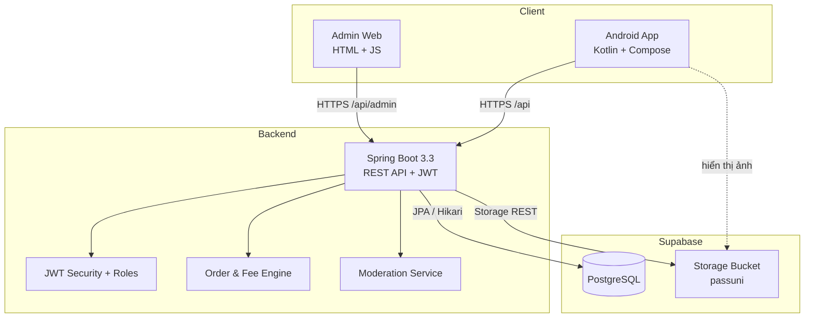
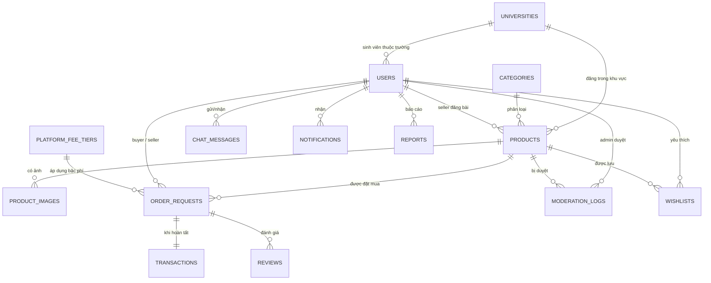
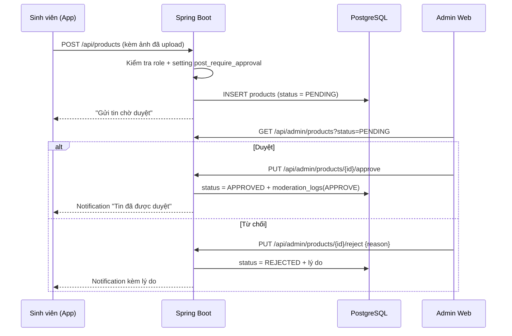
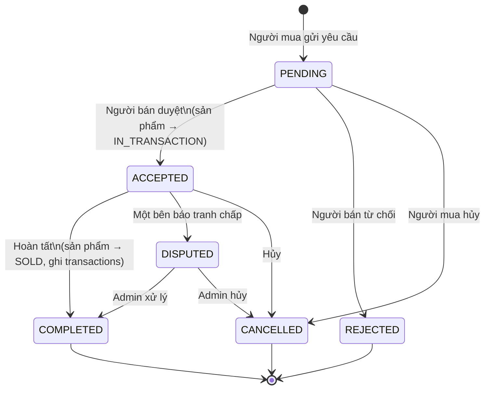
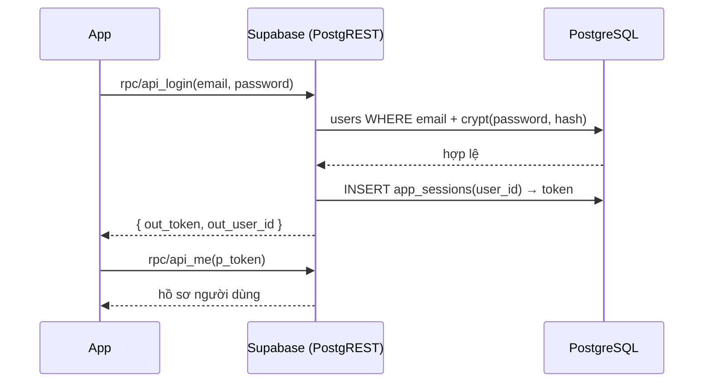

# PassUni — Tài liệu nâng cấp hệ thống (Phiên bản 3.0)

> Chợ đồ cũ sinh viên: **Android (Kotlin/Compose) + Spring Boot 3 + Supabase (PostgreSQL + Storage) + Admin Web**
> Cập nhật: 2026-11-02

---

## 1. Tóm tắt thay đổi

| Hạng mục | Trước | Sau |
|---|---|---|
| Phí sàn | 1 tỷ lệ cố định, tính lúc **hoàn tất** đơn | **Bậc phí theo giá trị**, bên chịu phí cấu hình được, **chốt ngay khi tạo đơn** |
| Trạng thái đơn | PENDING / ACCEPTED / COMPLETED / REJECTED / CANCELLED | Thêm **DISPUTED** (tranh chấp) + audit ai đổi trạng thái |
| Duyệt bài | Client tự gửi `autoApprove=true` → **bài hiện ngay** | Server quyết định: mặc định **PENDING**, chỉ Admin/Moderator mới auto-approve |
| Nhật ký duyệt | Không có | Bảng `moderation_logs` (ai duyệt, lý do, thời điểm) |
| Upload ảnh | Lưu local `./uploads`, mất khi deploy | **Supabase Storage** (fallback local khi dev) |
| Avatar | Không đổi được | `PUT /api/auth/avatar` + chọn ảnh trong app |
| Dữ liệu fix cứng | Mobile có sẵn danh sách sản phẩm/user mẫu | **Đã xóa**, toàn bộ lấy từ API; dữ liệu mẫu nằm trong `seed_data.sql` |
| Admin | Thiếu quản lý đơn, không cấu hình bậc phí | Thêm quản lý đơn, bậc phí, bên chịu phí, nhật ký duyệt |

---

## 2. Kiến trúc tổng thể



---

## 3. Cơ sở dữ liệu

### 3.1. Sơ đồ quan hệ (ERD)



### 3.2. File schema

Chỉ còn **một** file schema duy nhất:

| File | Mục đích |
|---|---|
| **`database_schema.sql`** | Toàn bộ schema cuối cùng: bảng, cột, index, bậc phí, settings mặc định, view doanh thu. Dùng cho cả **cài mới** và **nâng cấp** (idempotent) |
| `seed_data.sql` | Dữ liệu mẫu (trường, danh mục, user, sản phẩm, đơn, giao dịch) |

Thứ tự chạy:

```bash
psql "$SUPABASE_DB_URL" -f database_schema.sql
psql "$SUPABASE_DB_URL" -f seed_data.sql      # tuỳ chọn
```

> File schema dùng `CREATE TABLE IF NOT EXISTS` và `ALTER TABLE ... ADD COLUMN IF NOT EXISTS`, nên chạy lại trên database cũ vẫn an toàn: chỉ bổ sung phần thiếu, không xóa dữ liệu.
> Hibernate vẫn để `ddl-auto=update` cho tiện dev, nhưng **view `v_platform_revenue` và index phải chạy bằng file SQL**.

### 3.3. Bảng `platform_fee_tiers` (mới)

| Cột | Kiểu | Ý nghĩa |
|---|---|---|
| `name` | varchar | Tên bậc, ví dụ "Đơn nhỏ (< 100.000đ)" |
| `min_amount` | numeric | Giá trị đơn từ |
| `max_amount` | numeric (nullable) | Giá trị đơn đến, `NULL` = không giới hạn |
| `fee_rate` | numeric(5,4) | `0.03` = 3% |
| `priority` | int | Số lớn được ưu tiên khi khoảng trùng |
| `active` | boolean | Admin có thể tắt thay vì xóa |

### 3.4. Cột mới của `order_requests`

| Cột | Ý nghĩa |
|---|---|
| `order_code` | Mã hiển thị, ví dụ `PD000123` |
| `fee_payer` | `SELLER` / `BUYER` / `SPLIT` |
| `fee_tier_id` | Bậc phí đã áp dụng (snapshot) |
| `platform_fee_rate`, `platform_fee_amount` | Phí đã **chốt lúc tạo đơn** |
| `final_seller_amount`, `final_buyer_amount` | Tiền người bán nhận / người mua trả |
| `confirmed_at`, `completed_at` | Mốc thời gian |
| `cancel_reason`, `dispute_reason`, `admin_note` | Lý do / ghi chú |
| `status_updated_by` | User cuối cùng đổi trạng thái |

---

## 4. Công thức tính phí sàn

```
rate     = bậc phí khớp giá trị đơn  (nếu không khớp → platform_fee_rate)
fee_raw  = amount × rate
fee      = làm tròn(fee_raw, fee_round_step)      # mặc định 1.000đ
fee      = max(fee, min_platform_fee)             # mặc định 2.000đ
fee      = min(fee, max_platform_fee)             # 0 = không giới hạn
fee      = min(fee, amount)                       # không thu quá giá trị đơn
```

Phân chia theo `fee_payer`:

| fee_payer | Người bán nhận | Người mua trả |
|---|---|---|
| `SELLER` (mặc định) | `amount − fee` | `amount` |
| `BUYER` | `amount` | `amount + fee` |
| `SPLIT` | `amount − fee/2` | `amount + fee/2` |

**Ví dụ** — đơn 500.000đ, bậc "Đơn vừa" 4%, người bán chịu phí:

```
fee = 500.000 × 4% = 20.000đ
người bán nhận = 480.000đ
```

API xem trước: `GET /api/orders/fee-preview?amount=500000`

---

## 5. Luồng nghiệp vụ

### 5.1. Đăng bài → Admin duyệt



Quy tắc:
- Sinh viên sửa lại bài đã duyệt → bài **quay về PENDING** để duyệt lại.
- Admin/Moderator đăng bài → được duyệt ngay.
- Tắt `post_require_approval=false` → mọi bài hiện ngay (dùng khi demo nhanh).

### 5.2. Đặt mua → Duyệt → Hoàn tất (có phí sàn)



Chi tiết:
1. **Tạo đơn** — hệ thống tính và lưu phí ngay (`platform_fee_rate`, `platform_fee_amount`, `final_*`), sinh `order_code`, gửi chat + notification.
2. **Người bán duyệt** — chỉ khi `PENDING`; sản phẩm → `IN_TRANSACTION`.
3. **Hoàn tất** — chỉ khi `ACCEPTED`; dùng **phí đã chốt**, ghi `transactions`, sản phẩm → `SOLD`, tăng `completed_deals`.
4. **Admin can thiệp** — `PUT /api/admin/orders/{id}/status` với `ACCEPTED | COMPLETED | CANCELLED | REJECTED | DISPUTED`.

---

## 6. Phân quyền

| Role | Quyền |
|---|---|
| `STUDENT` | Đăng bài (chờ duyệt), mua/bán, chat, wishlist, báo cáo, đổi avatar |
| `MODERATOR` | Toàn bộ quyền student + duyệt/từ chối/ẩn bài |
| `ADMIN` | Toàn quyền: user, bài, đơn, phí sàn, báo cáo, cài đặt |

Ràng buộc ở tầng API (`SecurityConfig`) và tầng service:

```java
.requestMatchers("/api/admin/**").hasRole("ADMIN")
```

- Người dùng bị khóa (`active=false`) không đăng nhập được.
- Mọi endpoint đọc/ghi đơn đều kiểm tra người gọi là **buyer**, **seller** hoặc **ADMIN**.
- API công khai: `GET /api/products`, `/api/categories`, `/api/universities`, `/api/auth/**`, `/uploads/**`, swagger.

> **Lưu ý bảo mật**: `/api/admin/**` hiện chỉ cho `ADMIN`; nếu muốn Moderator duyệt bài, đổi thành `.hasAnyRole("ADMIN","MODERATOR")` và siết các endpoint phí/cài đặt riêng.

---

## 7. Màn hình Admin

| Mục | Chức năng |
|---|---|
| **Tổng quan** | Số sinh viên, bài đăng, đơn, doanh thu phí sàn, biểu đồ theo danh mục/trường |
| **Duyệt bài** | Danh sách PENDING, xem chi tiết, duyệt / từ chối kèm lý do |
| **Quản lý sản phẩm** | Lọc theo trạng thái, tìm kiếm, xem, duyệt, ẩn, xóa |
| **Quản lý đơn hàng** | Mã đơn, người mua/bán, giá, **phí sàn**, tiền người bán nhận, trạng thái, nút Duyệt / Hoàn tất / Hủy |
| **Tài chính & phí sàn** | Tổng phí thu, tổng GMV, cấu hình tỷ lệ/min/max, bên chịu phí, **bảng bậc phí CRUD**, mô phỏng phí, lịch sử giao dịch |
| **Người dùng** | Lọc role, khóa/mở khóa, xác thực sinh viên, đổi role |
| **Báo cáo vi phạm** | Xử lý / bác bỏ báo cáo |
| **Cài đặt** | Toàn bộ `platform_settings` + kiểm tra kết nối backend |

Tài khoản mặc định (sau khi seed):

| Vai trò | Email | Mật khẩu |
|---|---|---|
| Admin | `admin@chodocu.edu.vn` | `admin123` |
| Moderator | `mod@passuni.vn` | `password123` |
| Sinh viên (app) | `minhthu@student.vnuhcm.edu.vn` | `123456` |
| Sinh viên (app) | `hoangphuc@uit.edu.vn` | `123456` |

---

## 8. Danh sách API chính

### Auth & hồ sơ

| Method | Endpoint | Mô tả |
|---|---|---|
| POST | `/api/auth/register` | Đăng ký |
| POST | `/api/auth/login` | Đăng nhập (JWT) |
| GET | `/api/auth/me` | Thông tin hiện tại |
| PUT | `/api/auth/profile` | Sửa họ tên, SĐT, KTX, bio, avatar, trường |
| PUT | `/api/auth/avatar` | **Chỉ đổi avatar** |
| POST | `/api/upload?folder=avatars` | Upload ảnh → Supabase Storage |
| POST | `/api/upload/avatar` | Upload avatar (shortcut) |

### Sản phẩm

| Method | Endpoint | Mô tả |
|---|---|---|
| GET | `/api/products` | Tìm kiếm (chỉ APPROVED) |
| POST | `/api/products` | Đăng bài → PENDING (trừ admin) |
| PUT | `/api/products/{id}` | Sửa bài → duyệt lại |
| PATCH | `/api/products/{id}/status` | Đổi trạng thái |
| GET | `/api/products/my-posts` | Bài của tôi |

### Đơn hàng

| Method | Endpoint | Mô tả |
|---|---|---|
| GET | `/api/orders/fee-preview?amount=` | Xem trước phí sàn |
| POST | `/api/orders` | Tạo yêu cầu đặt mua |
| PUT | `/api/orders/{id}/accept` | Người bán duyệt |
| PUT | `/api/orders/{id}/complete` | Hoàn tất (chốt phí) |
| PUT | `/api/orders/{id}/reject` | Từ chối / hủy |
| PUT | `/api/orders/{id}/dispute` | Báo tranh chấp |
| GET | `/api/orders/{id}` | Chi tiết đơn |

### Admin

| Method | Endpoint | Mô tả |
|---|---|---|
| GET | `/api/admin/stats` | Dashboard |
| GET | `/api/admin/products?status=` | Duyệt / quản lý bài |
| PUT | `/api/admin/products/{id}/approve` | Duyệt |
| PUT | `/api/admin/products/{id}/reject` | Từ chối |
| PUT | `/api/admin/products/{id}/hide?hidden=` | Ẩn / hiện |
| GET | `/api/admin/moderation-logs` | Nhật ký duyệt |
| GET | `/api/admin/orders?status=` | Toàn bộ đơn |
| PUT | `/api/admin/orders/{id}/status` | Can thiệp trạng thái đơn |
| GET/POST/PUT/DELETE | `/api/admin/fee-tiers` | CRUD bậc phí |
| GET | `/api/admin/fee/preview?amount=` | Mô phỏng phí |
| GET | `/api/admin/financial` | Báo cáo tài chính |
| GET/PUT | `/api/admin/settings` | Cấu hình hệ thống |

---

## 9. Kết nối Supabase

### 9.1. Database

`application.properties` đọc từ biến môi trường (có giá trị mặc định cho dev):

```properties
spring.datasource.url=${SUPABASE_DB_URL:jdbc:postgresql://...pooler.supabase.com:5432/postgres?sslmode=require}
spring.datasource.username=${SUPABASE_DB_USER:postgres.ovxnlepmewindufcgxln}
spring.datasource.password=${SUPABASE_DB_PASSWORD:...}
```

Nên đặt biến môi trường khi deploy:

```powershell
$env:SUPABASE_DB_URL="jdbc:postgresql://...:5432/postgres?sslmode=require"
$env:SUPABASE_DB_USER="postgres.ovxnlepmewindufcgxln"
$env:SUPABASE_DB_PASSWORD="<mật-khẩu-db>"
$env:JWT_SECRET="<chuỗi-ngẫu-nhiên-64-ký-tự>"
```

### 9.2. Storage (ảnh)

1. Supabase Dashboard → **Storage** → tạo bucket **public** tên `passuni`.
2. Tạo policy cho phép `anon` đọc (public bucket) và backend ghi bằng service role.
3. Lấy **service_role key** → đặt biến môi trường:

```powershell
$env:SUPABASE_SERVICE_KEY="<service-role-key>"
$env:SUPABASE_STORAGE_BUCKET="passuni"
```

Nếu chưa có service key, backend tự fallback lưu vào `./uploads` (tiện dev) và phục vụ qua `/uploads/**`.

---

## 10. Cấu hình phí sàn (dành cho Admin)

Truy cập **Tài chính & Phí sàn**:

1. **Tỷ lệ cơ bản** — dùng khi đơn không khớp bậc nào.
2. **Phí tối thiểu / tối đa** — chặn phí quá nhỏ hoặc quá lớn (`0` = không giới hạn).
3. **Bên chịu phí** — Người bán / Người mua / Chia đôi.
4. **Bậc phí** — thêm/sửa/tắt theo khoảng giá trị, ưu tiên số lớn.
5. **Mô phỏng** — xem ngay phí và số tiền người bán nhận cho 50k / 500k / 2 triệu.

Bảng `platform_settings` tương ứng:

| Key | Giá trị mặc định |
|---|---|
| `platform_fee_rate` | `0.05` |
| `min_platform_fee` | `2000` |
| `max_platform_fee` | `50000` |
| `fee_enabled` | `true` |
| `fee_payer` | `SELLER` |
| `fee_round_step` | `1000` |
| `post_require_approval` | `true` |
| `order_auto_cancel_hours` | `72` |

---

## 11. App mobile — thay đổi chính

- **Bỏ toàn bộ dữ liệu mẫu** (`defaultProducts`, `defaultUsers`, `defaultOrders`…) → mọi danh sách lấy từ API.
- Đăng nhập/đăng ký **không còn fallback giả lập**; lỗi mạng hiển thị popup rõ ràng.
- Đăng bài: gửi ảnh (nếu có) → báo "chờ admin duyệt" khi `status = PENDING`.
- Đặt mua: hiển thị **mã đơn** và **phí sàn tạm tính** lấy từ backend.
- Thêm `completeOrder()` — hoàn tất và hiển thị phí + số tiền người bán nhận.
- **Profile**: chạm vào avatar → chọn ảnh → upload Supabase → cập nhật hồ sơ.
- Form đăng ký không prefill thông tin cá nhân; gợi ý domain email lấy từ danh sách trường.

Đổi địa chỉ backend tại `RetrofitClient.kt`:

```kotlin
// Emulator: 10.0.2.2 | Máy thật: IP LAN của PC
private const val BASE_URL = "http://10.0.2.2:8080/api/"
```

---

## 12. Kiểm thử nhanh (checklist)

```bash
# 1. Build backend
cd chodocu-backend
mvnw.cmd -DskipTests compile

# 2. Chạy backend
mvnw.cmd spring-boot:run

# 3. Kiểm tra phí sàn
curl "http://localhost:8080/api/orders/fee-preview?amount=500000" \
  -H "Authorization: Bearer <token>"
```

Checklist chức năng:

- [ ] Đăng ký sinh viên mới → nhận JWT.
- [ ] Đăng bài → trạng thái `PENDING`, **không** xuất hiện trên feed.
- [ ] Admin duyệt → bài xuất hiện trên feed + có notification.
- [ ] Sinh viên khác đặt mua → đơn `PENDING`, có `orderCode`, phí sàn đã chốt.
- [ ] Người bán duyệt → sản phẩm `IN_TRANSACTION`.
- [ ] Bấm hoàn tất → sinh `transactions`, admin thấy phí trong báo cáo.
- [ ] Đổi avatar trong app → ảnh lưu trên Supabase Storage.
- [ ] Admin đổi `fee_payer` sang `BUYER` → đơn mới tính lại đúng.
- [ ] Tắt `fee_enabled` → phí = 0, người bán nhận đủ.
- [ ] Báo tranh chấp → đơn `DISPUTED`, admin xử lý được.

---

## 13. Danh sách file đã thay đổi

### Backend

| File | Nội dung |
|---|---|
| `database_schema.sql` | **Schema duy nhất** — bảng, cột, index, bậc phí, settings, view doanh thu |
| `seed_data.sql` | Cập nhật settings/bậc phí/đơn mẫu + tài khoản demo |
| `entity/PlatformFeeTier.java` | **Mới** |
| `entity/ModerationLog.java` | **Mới** |
| `entity/OrderRequest.java` | Thêm mã đơn, phí, mốc thời gian, tranh chấp |
| `entity/Product.java` | Mặc định `PENDING` |
| `enums/OrderStatus.java` | Thêm `DISPUTED`, `isFinal()` |
| `repository/PlatformFeeTierRepository.java` | **Mới** |
| `repository/ModerationLogRepository.java` | **Mới** |
| `service/PlatformSettingService.java` | Bậc phí, bên chịu phí, làm tròn, validate, CRUD |
| `service/OrderService.java` | Chốt phí khi tạo đơn, state machine, tranh chấp, admin override |
| `service/AdminService.java` | Audit duyệt bài, danh sách đơn, ẩn/hiện bài |
| `service/ProductService.java` | Duyệt do server quyết định, duyệt lại khi sửa |
| `service/FileUploadService.java` | Supabase Storage + fallback local |
| `service/AuthService.java` | Cập nhật avatar & profile đầy đủ |
| `config/DataInitializer.java` | Seed settings, bậc phí, đơn mẫu có phí |
| `config/WebConfig.java` | **Mới** — phục vụ `/uploads/**` |
| `controller/*` | Endpoint mới: fee-preview, dispute, admin orders, fee-tiers, avatar |
| `dto/admin/FeeTierDto.java`, `FeeCalculationResponse.java` | **Mới** |
| `dto/order/OrderResponse.java` | Bổ sung trường phí/trạng thái |
| `application.properties` | Biến môi trường Supabase/JWT/Storage |

### Admin Web

| File | Nội dung |
|---|---|
| `index.html` | Login đúng tài khoản seed, cột thao tác đơn, bảng bậc phí, chọn bên chịu phí, modal bậc phí |
| `admin.js` | Gọi `/admin/orders`, cập nhật trạng thái đơn, CRUD bậc phí, mô phỏng phí qua API |

### Mobile

| File | Nội dung |
|---|---|
| `data/model/Models.kt` | `FeeCalculationDto`, `UpdateProfileRequest`, `OrderDto` mở rộng |
| `data/api/ApiService.kt` | `updateProfile`, `updateAvatar`, `uploadImage`, `previewFee` |
| `viewmodel/MainViewModel.kt` | Xóa dữ liệu mẫu, gọi API thật, `uploadAvatar`, `updateProfile`, `completeOrder` |
| `ui/screens/PassUniScreens.kt` | Chọn avatar trong Profile, bỏ prefill, domain email động |
| `MainActivity.kt` | Bỏ fallback sản phẩm mẫu khi mở chi tiết |

---

## 14. Ghi chú triển khai

1. **Không commit service role key** — chỉ dùng biến môi trường.
2. `ddl-auto=update` phù hợp dev; production nên dùng `validate` + chạy migration SQL.
3. Nên bật RLS trên Supabase cho các bảng nếu client truy cập trực tiếp; hiện app đi qua backend nên backend là điểm kiểm soát chính.
4. `order_auto_cancel_hours` mới là **cấu hình**, cần thêm cron job (`@Scheduled`) nếu muốn tự hủy đơn treo.
5. Thanh toán thực tế (VNPay/MoMo) chưa tích hợp — hiện ghi nhận phí ở mức nghiệp vụ.

---

## 15. Thiết kế lại UI/UX mobile (v3.1)

### 15.1. Vấn đề của bản cũ

| Vấn đề | Biểu hiện |
|---|---|
| Quá nhiều màu | Gradient cam → xanh, badge xanh lá/vàng/tím cạnh nhau |
| Emoji làm icon | `🎁 Tặng 0đ`, `🎓 SV Bán Đồ`, `🛒`, `🛡️`, `💰` trong tiêu đề popup |
| Không có phân cấp chữ | `ExtraBold` dùng cho gần như mọi tiêu đề và nhãn |
| Bo góc quá lớn | 20–24dp cho mọi card, pill 50% cho mọi nhãn |
| Dữ liệu giả hiển thị | `4.9★` hardcode trong thẻ sản phẩm, "Tiết kiệm 60%", "Đã chốt 24 đơn" |
| Thẻ sản phẩm nặng | Ảnh 180dp + badge + nút tim + rating + 2 dòng giá trong 1 thẻ |

### 15.2. Hướng thiết kế mới

- **Nền trung tính**: `#F6F7F8`, card trắng + viền 1px `#E4E7EC`, không đổ bóng nặng.
- **Một màu thương hiệu**: emerald `#0B6B4A` chỉ dùng cho giá, hành động chính, trạng thái tích cực.
- **Màu ngữ nghĩa** dùng tiết chế: cảnh báo `#B4530A`, lỗi `#B42318`, thông tin `#0D5C8C`.
- **Bo góc nhỏ, nhất quán**: 8 / 12 / 16 / 20 (chip / input / card / sheet).
- **Thang chữ Material 3**: `headlineSmall` 22sp → `titleMedium` 15sp → `bodyMedium` 13sp → `labelSmall` 11sp; chỉ tiêu đề dùng SemiBold.
- **Không emoji trong UI**: thay bằng icon Material hoặc bỏ hẳn.
- **Thẻ sản phẩm 1 khối thông tin**: ảnh 4:3 → giá (kèm giá gốc gạch ngang) → tiêu đề 2 dòng → `trường · thời gian` → tình trạng.

### 15.3. File & thành phần mới

| File | Nội dung |
|---|---|
| `ui/theme/Theme.kt` | Bảng màu trung tính, typography M3, shapes 6–20dp |
| `ui/theme/DesignTokens.kt` | `Space`, `Radius`, `Elevation` dùng chung |
| `ui/components/PassUniComponents.kt` | `PassUniAvatar`, `SectionHeader`, `ProductCard`, `ProductStatusChip`, `InfoStrip`, `PassUniEmptyState`, `FilterPill`, `DemoAccountButton`, `formatPrice` |
| `ui/components/PassUniDialogs.kt` | Popup/dialog bo góc nhỏ, chữ theo thang M3, bỏ prefill ghi chú cá nhân |

### 15.4. Màn hình đã làm lại

| Màn hình | Thay đổi |
|---|---|
| **Đăng nhập / Đăng ký** | Bỏ nền + logo gradient, bỏ 3 badge màu; gộp thành 1 dòng tin cậy. Khối "Tài khoản dùng thử" phẳng, không emoji, sửa email demo đúng seed (`admin@chodocu.edu.vn`, `hoangphuc@uit.edu.vn`) |
| **Trang chủ** | Header gọn (avatar + tên + trường), ô tìm kiếm 12dp, pill lọc không emoji, dải thông tin thay banner gradient, `ProductCard` mới |
| **Chi tiết tin** | Ảnh 4:3, giá dùng `headlineSmall`, mức giảm tính thật từ `originalPrice`, thẻ người bán dùng dữ liệu thật (trường, số giao dịch, SĐT), bỏ "Tiết kiệm 60%" và "Đã chốt 24 đơn" giả |
| **Cá nhân** | Thẻ sinh viên nền ink phẳng (bỏ neon mint), điểm uy tín / giao dịch / vai trò lấy từ API, avatar chạm để đổi |
| **Đăng tin** | Không prefill giá/điểm hẹn; chọn danh mục & trường động từ API; validate tên, danh mục, giá; nút "Gửi tin chờ duyệt" |
| **Chat** | Đối tác lấy từ tin nhắn thay vì hardcode "Lê Hoàng Yến"; bỏ chấm "đang trực tuyến" giả; bubble viền 1px, thẻ sản phẩm trung tính |
| **Popup & dialog** | Icon 48dp, chữ `titleMedium`/`bodyMedium`, nút 46dp bo 12dp |

### 15.5. Đối chiếu nhanh khi thêm màn mới

1. Dùng `Space.*` và `Radius.*` — không hardcode `16.dp` / `20.dp` rải rác.
2. Chữ lấy từ `MaterialTheme.typography.*` — không tự set `fontSize`/`FontWeight.ExtraBold`.
3. Chỉ dùng `EmeraldPrimary` cho 1 điểm nhấn mỗi màn (giá hoặc CTA).
4. Không thêm emoji vào text UI; dùng `Icons.Outlined.*`.
5. Số liệu hiển thị phải lấy từ API, không đặt giá trị mẫu.

### 15.6. Kiểm chứng

```powershell
cd chodocu-Frontend/mobile-app
gradlew.bat :app:compileDebugKotlin   # KOTLIN_OK
```

> Ghi chú: `formatVnd` cũ nay chỉ là wrapper gọi `formatPrice` (giữ để không phải sửa hàng loạt call-site). Component mới dùng trực tiếp `formatPrice`.

---

## 16. Chạy app KHÔNG cần backend (gọi thẳng Supabase)

App có thể bỏ qua Spring Boot và nói chuyện trực tiếp với Supabase (PostgREST + RPC).

### 16.1. Bật/tắt chế độ

`mobile-app/app/src/main/java/com/chodocu/app/core/AppConfig.kt`

```kotlin
object AppConfig {
    const val USE_SUPABASE_DIRECT = true          // true: gọi thẳng Supabase
    const val SUPABASE_URL = "https://<project>.supabase.co"
    const val SUPABASE_ANON_KEY = "sb_publishable_..."   // anon/publishable key
    const val STORAGE_BUCKET = "passuni"
    const val BACKEND_BASE_URL = "http://10.0.2.2:8080/api/"  // chỉ dùng khi tắt direct
}
```

### 16.2. Cài đặt phía Supabase (bắt buộc)

Chạy trong **SQL Editor**:

```
database_schema.sql      -- bảng + dữ liệu cấu hình
seed_data.sql            -- dữ liệu mẫu (tuỳ chọn)
supabase_direct_setup.sql  ← QUAN TRỌNG: view + RPC + session + quyền + storage
```

`supabase_direct_setup.sql` tạo:

| Thành phần | Vai trò |
|---|---|
| `app_sessions` | Phiên đăng nhập do server cấp (token UUID), thay cho JWT backend |
| `v_public_products` | Chỉ bài `APPROVED`, đã làm phẳng (tên trường, người bán, mảng ảnh) |
| `v_products`, `v_orders`, `v_chat_messages`, `v_user_profiles` | View nội bộ, **không** cấp quyền cho anon |
| `api_login`, `api_register`, `api_logout`, `api_me`, `api_update_profile` | Xác thực + hồ sơ |
| `api_create_product`, `api_delete_product`, `api_my_posts` | Đăng/sửa/xóa tin (server tự set `PENDING`) |
| `api_place_order`, `api_update_order`, `api_my_orders` | Đơn hàng + chốt phí sàn |
| `api_toggle_wishlist`, `api_my_wishlist` | Yêu thích |
| `api_messages`, `api_send_message` | Chat |
| `api_fee_preview` | Xem trước phí sàn |
| Storage policies cho bucket `passuni` | Upload ảnh/avatar bằng anon key |

Quyền được siết bằng: `revoke all on all tables ... from anon`, bật RLS toàn bộ bảng,
chỉ `grant select` cho `categories`, `universities`, `v_public_products`, và
`grant execute` cho đúng danh sách RPC. Mọi ghi đều đi qua RPC `SECURITY DEFINER`
có kiểm tra session token → anon **không thể** ghi trực tiếp bảng.

### 16.3. Luồng dữ liệu trong app

```
App ──(anon key)──► PostgREST
                     ├─ GET  /rest/v1/v_public_products      (feed)
                     ├─ GET  /rest/v1/categories, universities
                     └─ POST /rest/v1/rpc/api_*              (có p_token)
                              ├─ api_login → token + user_id
                              ├─ api_me → hồ sơ
                              ├─ api_place_order → đơn + phí đã chốt
                              └─ api_update_order → duyệt/hoàn tất/hủy
App ──(anon key)──► Storage /object/passuni/...   (upload avatar, ảnh tin)
```

Session token lưu trong `SupabaseSession` (RAM). Đăng xuất gọi `api_logout` để xóa phiên.

### 16.4. Luồng đăng nhập



### 16.5. File phía app

| File | Nội dung |
|---|---|
| `core/AppConfig.kt` | Cờ `USE_SUPABASE_DIRECT`, URL, anon key |
| `data/supabase/SupabaseClient.kt` | Retrofit + OkHttp, tự gắn `apikey`/`Authorization` |
| `data/supabase/SupabaseService.kt` | Khai báo endpoint PostgREST + RPC |
| `data/supabase/SupabaseModels.kt` | Row snake_case → DTO của UI |
| `data/supabase/SupabaseRepository.kt` | Nghiệp vụ: feed, auth, đơn, chat, upload ảnh |
| `viewmodel/MainViewModel.kt` | Rẽ nhánh `if (AppConfig.USE_SUPABASE_DIRECT)` cho từng thao tác |

### 16.6. Khác biệt cần biết

| Hành vi | Backend (Spring) | Supabase trực tiếp |
|---|---|---|
| Token | JWT ký server | Session UUID trong `app_sessions` |
| Duyệt bài | Admin web | Admin web gọi backend **hoặc** sửa trực tiếp Supabase |
| Upload ảnh | API `/api/upload` | Storage REST (anon key + policy) |
| "Đánh dấu đang giao dịch / đã bán" | Đổi trạng thái trực tiếp | Do luồng đơn hàng quyết định (app chỉ hiện gợi ý) |
| Chat realtime | WebSocket | Chưa có realtime — gửi/nhận qua RPC khi mở chat |

> Lưu ý: anon key nằm trong app nên **không phải bí mật**. Toàn bộ bảo vệ dựa trên
> view + RPC + revoke quyền bảng. Không dùng `service_role` key trong app.


